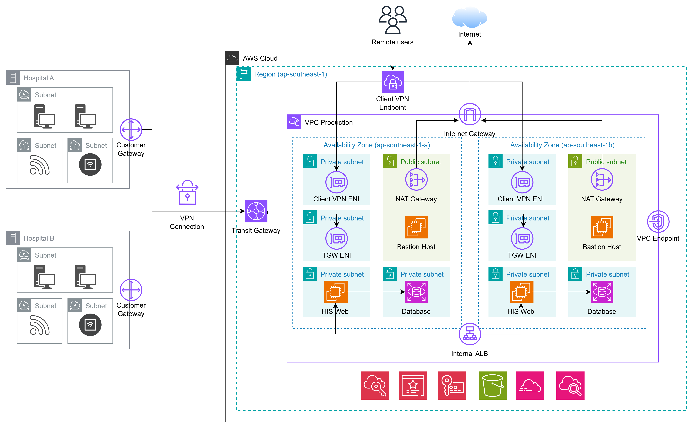

# TỔNG QUAN ĐỒ ÁN: THIẾT KẾ HẠ TẦNG MẠNG AWS CHO HỆ THỐNG 2 BỆNH VIỆN ĐA KHOA

> **Tóm tắt:** Đồ án xây dựng hạ tầng mạng AWS hoàn chỉnh kết nối 2 bệnh viện đa khoa on-premise với hệ thống quản lý bệnh viện (HIS/EMR) chạy trên cloud, đảm bảo an toàn, sẵn sàng cao và hỗ trợ bác sĩ truy cập từ xa – triển khai toàn bộ bằng Terraform (Infrastructure as Code).

---

## 1. BÀI TOÁN THỰC TẾ

Các bệnh viện đa khoa hiện đại đang đứng trước áp lực số hóa rất lớn, nhưng đi kèm với đó là hàng loạt thách thức kỹ thuật và vận hành nghiêm trọng:

### 1.1 Hồ sơ bệnh án phân tán – nguy cơ mất dữ liệu

Mỗi cơ sở bệnh viện truyền thống thường vận hành hệ thống lưu trữ hồ sơ bệnh nhân (EMR – Electronic Medical Record) độc lập, rời rạc. Khi bệnh nhân chuyển viện hoặc khám tại nhiều cơ sở, dữ liệu không được chia sẻ xuyên suốt, dẫn đến trùng lặp xét nghiệm, sai sót điều trị và rủi ro y tế. Dữ liệu lưu trên máy chủ nội bộ thiếu sao lưu, dễ mất do sự cố phần cứng.

### 1.2 Hệ thống quản lý bệnh viện không thể gián đoạn

Hệ thống HIS (Hospital Information System) điều phối toàn bộ hoạt động: từ tiếp nhận bệnh nhân, lên lịch phẫu thuật, kê đơn thuốc đến thanh toán viện phí. Bất kỳ sự cố downtime nào – dù chỉ vài phút – đều ảnh hưởng trực tiếp đến an toàn bệnh nhân và có thể gây hậu quả pháp lý. Đây là yêu cầu **uptime 24/7 không thỏa hiệp**.

### 1.3 Dữ liệu y tế là dữ liệu cá nhân nhạy cảm

Hồ sơ bệnh nhân thuộc nhóm dữ liệu cá nhân nhạy cảm được bảo vệ bởi các quy định pháp lý nghiêm ngặt. Bất kỳ hành vi truy cập trái phép, rò rỉ hoặc thất thoát dữ liệu đều gây ra hậu quả pháp lý, mất niềm tin bệnh nhân và thiệt hại uy tín tổ chức. Yêu cầu đặt ra là phải có khả năng **truy vết đầy đủ ai đã truy cập dữ liệu gì, lúc nào**.

### 1.4 Nhân viên IT mỏng – chi phí vận hành cao

Các bệnh viện thường không có đội ngũ IT chuyên sâu. Việc vận hành hạ tầng máy chủ vật lý đòi hỏi nhiều nhân lực bảo trì, nâng cấp, và xử lý sự cố phần cứng liên tục, làm tăng chi phí và rủi ro vận hành.

### 1.5 Bác sĩ cần truy cập hệ thống từ xa

Xu hướng telemedicine và các bác sĩ trực ca cần kết nối từ ngoài bệnh viện vào hệ thống HIS để xem hồ sơ bệnh nhân, ra y lệnh, tham khảo kết quả xét nghiệm. Nếu không có giải pháp kết nối an toàn, bác sĩ có thể sử dụng các kênh không bảo mật, tạo ra lỗ hổng nghiêm trọng.

---

## 2. LÝ DO CHỌN ĐỀ TÀI

Đề tài được chọn vì giải quyết trực tiếp **5 vấn đề cốt lõi** nêu trên thông qua một kiến trúc mạng cloud thực tiễn:

| Vấn đề | Giải pháp đề tài mang lại |
|--------|--------------------------|
| Dữ liệu phân tán, rủi ro mất mát | Tập trung dữ liệu lên AWS, backup tự động, Multi-AZ |
| Downtime không chấp nhận được | Kiến trúc HA với Multi-AZ, ALB health check, RDS failover tự động |
| Bảo mật dữ liệu nhạy cảm | Mã hóa end-to-end (KMS), IPsec VPN, phân vùng mạng, audit log |
| IT mỏng, vận hành phức tạp | Infrastructure as Code (Terraform), CloudWatch tự động cảnh báo |
| Bác sĩ truy cập từ xa an toàn | AWS Client VPN với xác thực certificate + MFA |

Ngoài ra, đề tài mang tính **học thuật và thực tiễn cao** vì:
- Áp dụng mô hình kiến trúc mạng Hub-and-Spoke đang được dùng rộng rãi trong enterprise thực tế
- Thực hành triển khai hạ tầng dưới dạng code (IaC), kỹ năng được thị trường lao động đánh giá rất cao
- Bao quát đầy đủ các khái niệm nền tảng: VPN, routing, network segmentation, encryption, monitoring

---

## 3. MỤC TIÊU ĐỒ ÁN

### 3.1 Mục tiêu chính

Xây dựng và triển khai hoàn chỉnh bằng **Terraform** một hạ tầng mạng AWS kết nối 2 bệnh viện đa khoa on-premise với hệ thống HIS/EMR chạy trên cloud, đáp ứng các tiêu chí:

- **Bảo mật (Security):** Mọi kết nối đều mã hóa; phân vùng mạng rõ ràng; audit log đầy đủ
- **Sẵn sàng cao (High Availability):** Không có điểm hỏng đơn lẻ (SPOF); tự động phục hồi
- **Khả năng vận hành (Operability):** Tự động hóa cấu hình; cảnh báo chủ động; dễ mở rộng
- **Kết nối an toàn (Secure Connectivity):** Cả mạng bệnh viện và bác sĩ cá nhân đều có đường vào hệ thống riêng, kiểm soát được

### 3.2 Phạm vi thực hiện

| Hạng mục | Nội dung |
|----------|---------|
| Mạng nền tảng | VPC, Subnet, Route Table, Security Group, NACL |
| Kết nối on-premise | Site-to-Site VPN qua Transit Gateway (2 bệnh viện) |
| Kết nối từ xa | AWS Client VPN (bác sĩ cá nhân) |
| Ứng dụng | EC2 chạy HIS mock, RDS lưu hồ sơ bệnh nhân |
| Cân bằng tải | Internal ALB (nội bộ, không public) |
| Bảo mật dữ liệu | KMS mã hóa EBS/RDS/S3, VPC Endpoint (PrivateLink) |
| Giám sát & Audit | CloudWatch, CloudTrail, VPC Flow Logs, SNS Alert |
| Tự động hóa | 100% triển khai bằng Terraform |

> **Lưu ý phạm vi:** Đây là đồ án học tập. 2 mạng bệnh viện on-premise được **giả lập bằng 2 VPC AWS riêng biệt** (đặt tên `VPC-OnPremise-1/2`), mỗi VPC có 1 máy EC2 chạy phần mềm StrongSwan đóng vai trò thiết bị VPN của bệnh viện. Cách tiếp cận này cho phép mô phỏng toàn bộ kịch bản kết nối thực tế mà không cần hạ tầng vật lý.

---

## 4. PHÂN TÍCH KIẾN TRÚC HỆ THỐNG MẠNG

### 4.1 Tổng quan kiến trúc

Hệ thống được thiết kế theo mô hình **Hub-and-Spoke** với AWS Transit Gateway là trung tâm điều phối, kết nối 3 nguồn lưu lượng khác nhau vào một VPC Production duy nhất:



### 4.2 Thiết kế kết nối On-Premise → AWS (Site-to-Site VPN)

**Vấn đề cần giải quyết:** Làm thế nào để mạng nội bộ của 2 bệnh viện (mỗi bệnh viện là một mạng riêng biệt về mặt địa lý) có thể kết nối ổn định, bảo mật và hiệu quả vào hệ thống AWS?

**Giải pháp được chọn: AWS Site-to-Site VPN + AWS Transit Gateway**

#### Tại sao dùng Transit Gateway thay vì kết nối thẳng VPC?

Nếu kết nối trực tiếp từng bệnh viện thẳng vào VPC Production (Virtual Private Gateway), khi hệ thống mở rộng thêm bệnh viện thứ 3, thứ 4... sẽ phải tạo thêm kết nối riêng lẻ cho từng cặp – cực kỳ phức tạp và khó quản lý. Transit Gateway đóng vai trò như một **bộ định tuyến trung tâm**, cho phép tất cả các bệnh viện kết nối vào một điểm duy nhất và thông qua đó đến được đích cần thiết.

#### Luồng kết nối chi tiết

```
Máy Workstation BV-1            Phía AWS Cloud
(192.168.10.x)                  ┌─────────────────────────────────────┐
       │                        │                                     │
       ▼                        │  AWS Transit Gateway                │
EC2 VPN Appliance BV-1          │  (Router trung tâm)                 │
(StrongSwan, IP Public)         │       │                             │
       │                        │       ├──► VPC Production           │
       │ ◄──── IPsec Tunnel 1 ──┤       │    (Ứng dụng HIS/EMR)      │
       │       (Mã hóa IKEv2)   │       │                             │
       │ ◄──── IPsec Tunnel 2 ──┤       │                             │
       │       (Dự phòng HA)    │  (Tương tự BV-2 qua Tunnel khác)   │
                                └─────────────────────────────────────┘
```

**Các thành phần kỹ thuật:**

- **Customer Gateway (CGW):** Đại diện cho thiết bị VPN phía bệnh viện (IP Public của EC2 StrongSwan)
- **VPN Connection:** Mỗi bệnh viện có 1 kết nối VPN, mỗi kết nối gồm **2 tunnel IPsec song song** để đảm bảo HA – nếu 1 tunnel gặp sự cố, tunnel còn lại tiếp quản ngay lập tức
- **Giao thức mã hóa:** IKEv2 + AES-256 + SHA-256 cho toàn bộ dữ liệu trên đường truyền (In-transit encryption)
- **Định tuyến:** Static Routing – cấu hình rõ ràng dải IP nào đi đâu, không phụ thuộc BGP

**Chính sách định tuyến bảo mật (Route Policy):**

Tại Transit Gateway, cấu hình Route Table theo nguyên tắc phân tách nghiêm ngặt:

| Nguồn | Đích cho phép | Đích bị chặn |
|-------|--------------|--------------|
| Bệnh viện 1 (192.168.10.0/24) | VPC Production | Bệnh viện 2 (và ngược lại) |
| Bệnh viện 2 (192.168.20.0/24) | VPC Production | Bệnh viện 1 (và ngược lại) |

> **Nguyên tắc:** Hai bệnh viện có thể truy cập hệ thống chung nhưng **không thể kết nối chéo với nhau** qua Transit Gateway – giảm thiểu rủi ro lan truyền tấn công mạng ngang hàng.

---

### 4.3 Thiết kế kết nối Bác sĩ từ xa → AWS (AWS Client VPN)

**Vấn đề cần giải quyết:** Bác sĩ làm việc tại nhà hoặc di chuyển cần truy cập hồ sơ bệnh nhân trên HIS từ máy tính cá nhân qua Internet công cộng – làm thế nào để đảm bảo an toàn tuyệt đối?

**Giải pháp được chọn: AWS Client VPN Endpoint**

Site-to-Site VPN phù hợp cho kết nối **mạng với mạng** (bệnh viện), nhưng bác sĩ là **người dùng cá nhân**, thiết bị đa dạng (laptop, máy tính cá nhân), không cố định địa điểm. Client VPN sinh ra cho đúng mô hình này.

#### Cơ chế hoạt động

```
Bác sĩ (Laptop cá nhân)
         │
         │  1. Mở AWS VPN Client app
         │  2. Xác thực bằng Certificate (Mutual TLS)
         │  3. Đường hầm TLS được thiết lập
         ▼
   Internet công cộng
         │
         ▼ (Được cấp IP từ dải 10.0.200.0/24)
AWS Client VPN Endpoint
(đặt trong Private Subnet của VPC Production)
         │
         ▼
VPC Production (10.0.4.0/22)
→ Internal ALB → App Server HIS
```

**Đặc điểm kỹ thuật quan trọng:**

- **Xác thực hai chiều (Mutual TLS / Certificate Authentication):** Cả server lẫn client đều phải xuất trình certificate hợp lệ. Server giả mạo không qua được, client không có certificate cũng không vào được
- **Split Tunneling:** Chỉ traffic đến dải IP nội bộ AWS (`10.0.4.0/22`) mới đi qua VPN. Traffic thông thường của bác sĩ (YouTube, email...) vẫn đi thẳng ra Internet – không gây tắc nghẽn VPN
- **Authorization Rules (Phân quyền truy cập):** Dải IP Client VPN (`10.0.200.0/24`) chỉ được phép vào VPC Production. Không có quyền truy cập bất kỳ dải mạng nào khác
- **Vị trí đặt Endpoint:** Client VPN Endpoint được **gắn trực tiếp vào một Private Subnet riêng** (`/28`) trong VPC Production, không đặt ngoài Internet, không đặt trong Public Subnet

---

### 4.4 Thiết kế hệ thống trong AWS – VPC Production

**Triết lý thiết kế:** Toàn bộ hạ tầng ứng dụng tập trung trong **1 VPC Production duy nhất** (CIDR: `10.0.4.0/22`). VPC này không có Internet Gateway – hoàn toàn private, chỉ nhận lưu lượng hợp lệ từ Transit Gateway hoặc Client VPN.

#### Sơ đồ phân tầng Subnet

```
VPC Production (10.0.4.0/22) – Trải rộng 2 Availability Zones
┌──────────────────────────────────────────────────────────────────┐
│                                                                  │
│  ┌─── AZ-A ──────────────────┐  ┌─── AZ-B ──────────────────┐  │
│  │                           │  │                           │  │
│  │ [TGW Subnet /28]          │  │ [TGW Subnet /28]          │  │
│  │  ENI nhận kết nối TGW     │  │  ENI nhận kết nối TGW     │  │
│  │                           │  │                           │  │
│  │ [Client VPN Subnet /27]   │  │ [Client VPN Subnet /27]   │  │
│  │  ENI nhận kết nối VPN     │  │  ENI nhận kết nối VPN     │  │
│  │                           │  │                           │  │
│  │ [Public Subnet]           │  │ [Public Subnet]           │  │
│  │  NAT Gateway              │  │  NAT Gateway (dự phòng)   │  │
│  │                           │  │                           │  │
│  │ [App Subnet – Private]    │  │ [App Subnet – Private]    │  │
│  │  EC2 App Server (HIS)     │  │  EC2 App Server (HIS)     │  │
│  │  Internal ALB             │  │  Internal ALB             │  │
│  │                           │  │                           │  │
│  │ [DB Subnet – Isolated]    │  │ [DB Subnet – Isolated]    │  │
│  │  RDS Primary              │  │  RDS Standby (Multi-AZ)   │  │
│  │                           │  │                           │  │
│  └───────────────────────────┘  └───────────────────────────┘  │
│                                                                  │
└──────────────────────────────────────────────────────────────────┘
```

#### Phân tích từng tầng Subnet

**① TGW Subnet (`/28` – siêu nhỏ, chỉ ~14 IP):**

Subnet chuyên dụng để đặt ENI (Elastic Network Interface) của Transit Gateway Attachment. Việc tách riêng subnet này có mục đích: cô lập điểm tiếp nhận lưu lượng từ bên ngoài vào, áp dụng Route Table và Security Group riêng biệt để kiểm soát chặt chẽ những gì được phép đi tiếp vào bên trong VPC.

**② Client VPN Subnet (`/27`):**

Tương tự TGW Subnet, đây là điểm tiếp nhận riêng cho kết nối của bác sĩ từ xa. Việc tách biệt hoàn toàn 2 nguồn lưu lượng (on-premise và remote user) vào 2 subnet khác nhau giúp áp dụng chính sách bảo mật và định tuyến độc lập cho từng loại.

**③ Public Subnet (chứa NAT Gateway):**

Đây là subnet duy nhất có đường ra Internet – nhưng chỉ theo **một chiều ra** (outbound only) thông qua NAT Gateway. Mục đích: App Server trong private subnet đôi khi cần tải bản cập nhật phần mềm, bảo mật từ Internet; NAT Gateway cho phép điều này mà không mở bất kỳ cổng inbound nào. **Không có Internet Gateway** vì VPC Production tuyệt đối không để nhận kết nối inbound từ Internet công cộng.

**④ App Subnet – Private (chứa EC2 HIS và Internal ALB):**

Nơi chạy phần mềm quản lý bệnh viện (HIS mock). Subnet này hoàn toàn private – không thể kết nối vào từ bên ngoài mà không đi qua ALB hoặc qua Client VPN. Internal ALB nằm đây để phân phối lưu lượng đến 2 App Server ở 2 AZ, đồng thời thực hiện health check và tự động ngắt kết nối đến server bị lỗi.

**⑤ DB Subnet – Isolated (chứa RDS):**

Tầng bảo mật cao nhất. Route Table của DB Subnet **không có bất kỳ route nào ra ngoài** – kể cả không có route đến TGW hay NAT Gateway. Đây là subnet "cô lập hoàn toàn": chỉ nhận và phản hồi kết nối từ App Subnet nội bộ thông qua Security Group. Ngay cả admin cũng không thể SSH trực tiếp vào database – phải qua App Server.

#### Luồng dữ liệu tổng thể

```
Workstation BV-1/BV-2                  Bác sĩ từ xa
       │                                    │
       │ IPsec VPN                          │ TLS Client VPN
       ▼                                    ▼
AWS Transit Gateway              Client VPN Endpoint
       │                                    │
       └──────────────┬─────────────────────┘
                      │
                      ▼ (vào VPC Production)
             Internal ALB (Layer 7)
             Health check / SSL termination
                      │
          ┌───────────┴───────────┐
          ▼                       ▼
   EC2 App Server AZ-A     EC2 App Server AZ-B
          │                       │
          └───────────┬───────────┘
                      │
              RDS MySQL/PostgreSQL
              (Primary AZ-A ↔ Standby AZ-B)
```

#### Các cơ chế bảo mật bổ sung trong VPC

**VPC Endpoints (AWS PrivateLink):**
Khi App Server cần giao tiếp với các dịch vụ AWS khác (S3 lưu ảnh X-quang, KMS lấy khóa mã hóa, Secrets Manager lấy mật khẩu DB), lưu lượng **không đi ra Internet** dù chỉ một byte. Thay vào đó, VPC Endpoint tạo một "đường nội bộ riêng" trong hạ tầng AWS để kết nối trực tiếp và bảo mật.

**Mã hóa dữ liệu lưu trữ (At-rest Encryption):**
Toàn bộ EBS (ổ cứng EC2), RDS, và S3 đều được mã hóa bằng AWS KMS. Khóa mã hóa được quản lý tập trung, tự động xoay vòng (key rotation) theo định kỳ.

**Audit Logging đầy đủ:**
- **CloudTrail:** Ghi lại mọi hành động API trên AWS (ai tạo/xóa/sửa resource nào, lúc nào, từ IP nào)
- **VPC Flow Logs:** Ghi lại mọi luồng kết nối IP vào/ra từng subnet (ai kết nối đến đâu, cổng nào, bao nhiêu bytes)
- **ALB Access Logs:** Ghi lại mọi HTTP request đến ứng dụng HIS

---

## 5. TỔNG KẾT

| Khía cạnh | Giải pháp | Công nghệ |
|-----------|-----------|-----------|
| Kết nối BV → AWS | Mạng riêng mã hóa, 2 tunnel dự phòng | Site-to-Site VPN + Transit Gateway |
| Kết nối Bác sĩ → AWS | Xác thực certificate, split tunnel | AWS Client VPN |
| Phân tách lưu lượng | Subnet riêng cho từng loại kết nối | VPC Subnet Design |
| Không điểm hỏng đơn | Dual-AZ cho tất cả thành phần quan trọng | Multi-AZ + ALB |
| Bảo mật dữ liệu | Mã hóa toàn bộ, không ra Internet | KMS + VPC Endpoint |
| Giám sát & Truy vết | Cảnh báo tự động, log đầy đủ | CloudWatch + CloudTrail + Flow Logs |
| Triển khai & Vận hành | Tự động hóa 100%, tái sử dụng được | Terraform (IaC) |